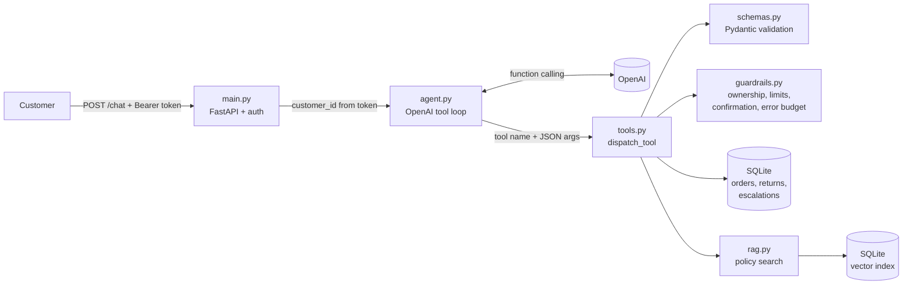

# Customer Support Agent

A production-style customer support backend for an Indian e-commerce store. Customers chat in plain language; an OpenAI model looks up orders, answers policy questions, cancels orders and files returns through tools — while **every business rule is enforced in Python, not in the prompt**.

Built with FastAPI, raw `sqlite3`, the OpenAI SDK (function calling, no LangChain), and Pydantic v2. 50 offline tests cover the guardrails.

---

## Why this project

Most LLM agent demos trust the model to follow its instructions. This one assumes the model will eventually get confused or manipulated, and makes sure that can't cost money or leak data:

| Guardrail | How it's enforced |
|---|---|
| **Ownership** — a customer can only see and act on their own orders | `customer_id` comes from the auth token and is injected by Python. It isn't in any tool schema, extra arguments are rejected, and every order query includes `AND customer_id = ?`. |
| **Refund limit** — refunds above ₹2,000 need a human | The return tool computes the refund in integer paise and, above 200,000 paise, files it as *requested* and creates an escalation **in the same DB transaction**. The model can't approve it or skip the escalation. |
| **Confirmation** — nothing changes without the customer saying yes | Cancel/return run in two steps: a preview issues a single-use token tied to the exact action, redeemable only on a *later* customer turn. "Can I cancel order 5?" alone can't cancel anything. |
| **Error budget** — repeated failures go to a human | If the same tool fails twice in a session, Python creates the escalation itself. |
| **Return policy** — 30-day window, non-returnable items, 7-day defect reports | Checked in `guardrails.py` before any write. |
| **No raw SQL from the LLM** | Tools are plain Python functions with fixed, parameterised queries. The model only supplies validated, typed values. |
| **Out-of-scope requests** | The one judgement only the model can make — handled by the system prompt plus an `escalate_to_human` tool. |

## Architecture



The model decides *what* to do; Python decides *whether it's allowed*.

## Project structure

```
support_agent/
├── app/
│   ├── main.py         # FastAPI app, bearer-token auth, /chat and /health
│   ├── agent.py        # OpenAI function-calling loop, system prompt, sessions
│   ├── tools.py        # Tool functions + dispatcher (injects customer_id)
│   ├── guardrails.py   # All business rules and limits
│   ├── schemas.py      # Pydantic models for tool args, results, API
│   ├── rag.py          # Policy chunking, embeddings, SQLite vector search
│   ├── db.py           # Connections, schema init, money/time helpers
│   ├── seed.py         # Deterministic demo data with test scenarios
│   ├── schema.sql      # Database schema (money stored as integer paise)
│   └── policy.txt      # Store policy (source for search_policy)
├── tests/              # 50 offline tests (no API key needed)
├── pytest.ini
└── requirements.txt
```

## Setup

Requires Python 3.11+ and an OpenAI API key.

```powershell
python -m venv venv
venv\Scripts\activate            # macOS/Linux: source venv/bin/activate
pip install -r requirements.txt

$env:OPENAI_API_KEY = "sk-..."   # macOS/Linux: export OPENAI_API_KEY=sk-...

python app/seed.py               # create and populate support.db
python app/rag.py build          # embed policy.txt into the vector index
```

## Run

**Terminal chat** (quickest way to try it):

```powershell
cd app
python agent.py --customer 1
```

**API:**

```powershell
uvicorn main:app --app-dir app --reload
```

Open http://127.0.0.1:8000/docs → **Authorize** with a demo token → try `POST /chat`:

```json
{"message": "Where is my order 4?"}
```

Send the returned `session_id` with follow-up messages to continue the conversation.

| Demo token | Customer | Useful for testing |
|---|---|---|
| `demo-priya` | Priya Sharma (id 1) | Every scenario: small refund, ₹4,499 refund, expired window, shipped, cancellable, non-returnable |
| `demo-rahul` | Rahul Verma (id 2) | Orders 8 and 9 — try reading them as Priya to test ownership |

The tokens are a development stand-in; replace `get_current_customer` in `main.py` with real authentication.

## Example conversation

> **Customer:** I want a refund for my running shoes
> **Agent:** You have the Stride Runner Running Shoes from order 2, delivered 10 days ago, so the return window is open. What's the reason for the return? *(tools: list_orders, get_order)*
>
> **Customer:** They don't fit, too small
> **Agent:** Here's the return request — Stride Runner Running Shoes, quantity 1, refund Rs. 4,499.00. Outcome if confirmed: sent to our team for review. Would you like to proceed? *(tool: request_return — preview only)*
>
> **Customer:** Yes
> **Agent:** Your return request has been submitted. A team member will review it and respond within 1–2 business days. Please note the shoes must be unworn and in the original box. *(tool: request_return — escalation #2 created)*

## Tests

```powershell
python -m pytest
```

50 tests run in about a second, fully offline: the chat model is a scripted fake that deliberately misbehaves (confirming in the same turn, looping forever, injecting `customer_id`) to show that Python stops it. Each test gets a freshly seeded temporary database.

| File | Covers |
|---|---|
| `test_guardrails.py` | ₹2,000 boundary, error budget, confirmation tokens |
| `test_tools.py` | Ownership and enumeration resistance, every return rule, cancellation, policy search |
| `test_agent.py` | Confirmation enforced against an eager model, loop cap, session binding |
| `test_api.py` | Auth, `customer_id` in body rejected, session hijacking (403), model outage (503) |

## Design decisions

- **Money as integer paise** everywhere; tools return both `paise` and a pre-formatted `display` string so the model quotes amounts instead of calculating them.
- **Structure-aware chunking** for the policy: split on sections and sub-headings so a rule is never cut in half, with the heading path prefixed to each chunk for better retrieval.
- **Brute-force cosine search in SQLite** — the policy is 11 chunks, so a linear scan is microseconds and avoids a native extension. `sqlite-vec` can replace it behind the same function.
- **Defect claims always go to a human**, even when the refund is small, because they require photo verification a chat agent can't do — and otherwise "defective" would bypass the non-returnable rule.
- **Same error for "not yours" and "doesn't exist"**, so order IDs can't be discovered by probing.

## Limitations and next steps

- Sessions are in memory — use Redis or a DB table before running multiple workers.
- Demo bearer tokens instead of real authentication.
- Out-of-scope detection depends on the model's judgement.
- No rate limiting yet.

---

Built by Sayantan Chaklader.